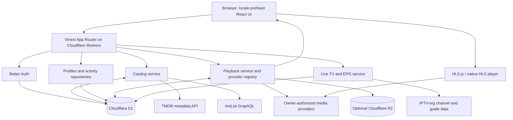

# OctoTV architecture

## Trust and rights boundaries

- TMDB/AniList are metadata sources, not playback providers. Their IDs are stored separately from provider asset identifiers.
- Playback adapters resolve only registered assets with active status, matching content/episode, allowed server, and valid licensing windows. Demo streams are reserved for demo catalog IDs.
- Signed playback/download tokens are short-lived, server-signed, and checked server-side. Provider credentials are never returned to client code.
- Download authorization also requires `downloadAllowed` and `rightsVerified`; demo assets do not qualify.
- Live TV records are sourced from IPTV-org listings/API and retain attribution. NSFW and blocked channels are filtered by default. Public listing is not proof of redistribution permission.
- D1 unavailability/unmigrated schema degrades read paths to configured public metadata or clearly labeled demo data; write paths report unavailable rather than claiming success.
- R2 is optional and is not used as a general-purpose video proxy.
